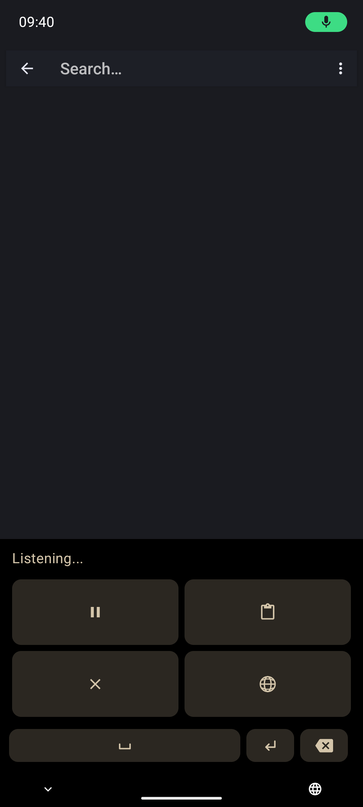

# Offline Speech to Text for Android

Private, on-device speech recognition for Android apps, keyboards, shared audio, and live captions. Install the current public build from [Zapstore](https://zapstore.dev/apps/app.offlinespeechtotext); source and development history live in the project-key-owned [Nostr repository](https://gitworkshop.dev/npub1jg2qmt3rxjksq65v3nk7dq6yaz2c4uf3qt9epdhxwms2xwd47j2s38a228/relay.ngit.dev/offline-speech-to-text).

## Features

- Dictate through Android's standard voice-input panel or `SpeechRecognizer` service; optionally move the panel to either side for one-handed use. Each ordinary dictation stays one continuous model run, so a hesitation cannot create a false sentence boundary. Whisper keeps its native context-aware windows. Very long inputs to other offline models use overlapping, quiet-point windows. Trusted shared words are reconciled with the later contextual hypothesis; if no safe alignment exists, both hypotheses are preserved rather than dropping speech.
- Use the optional voice keyboard in ordinary and privacy/no-learning text fields. If Compose or another UI toolkit recreates the composer while recognition finishes, OSTT follows Android's currently focused safe composer and inserts there without opening its own screen. If no writable composer exists, OSTT privately preserves one exact pending transcription for copy, keep, or delete instead of losing it. Password fields remain blocked.
- Reach pause/resume, cancel, insert-and-stay, and insert-and-switch in a compact 2×2 recording grid; use the rightmost globe to switch keyboards while idle, and watch the amber ring around the microphone while on-device transcription finishes.
- Hold and drag Backspace to highlight from the first character, move left or right one character at a time, and release to delete the selected range.
- Caption device audio with Live Subtitles, or open/share an audio file for transcription.
- Omit standalone “uh” (including uppercase variants) from known-English results while preserving sentence capitalization. Words such as “huh” and “uh-oh,” quoted speech, non-English output, and a filler-only utterance stay unchanged. For multilingual Parakeet, select English as the model language; Auto does not reliably identify it.
- Keep the APK and every future update small: on first setup OSTT recommends a verified model from the phone's memory, free storage, and system language, then downloads it once into update-safe private storage. Browse 53 exact downloads grouped by model family with plain-language differences and a per-family highlight for the largest model that should remain comfortable on the current phone. Parakeet TDT 0.6B v3 Q4 is the general default for 25 European languages; German-primary phones get the same-size, German-tuned Parakeet primeLine recommendation. Whisper and larger 1.1B Parakeet variants remain available. Add up to 128 preferred words or phrases in one private list. Whisper receives the first terms that fit its prompt; every model then restores the spelling and capitalization of exact single-word or multiword matches (including names such as `Wi-Fi` and `O’Reilly` with matching punctuation), corrects unique very close single-word spellings, and recognizes a few narrowly defined spoken forms such as `enpop` or `M pups` for `npub`. This is conservative cleanup, not native Parakeet phrase boosting or general phonetic matching: it will not blindly change a common word such as “mustard” to “Nostr.” Advanced, opt-in exact corrections remain available with separate **What was heard** and **Replace with** fields for other pronunciations or larger errors. Both dictionary passes skip quotations, code spans, URLs, email addresses, and dotted identifiers. Preferred terms keep their punctuation; compound-name parts are never fuzzy matches.
- Choose a goal—balanced, compact, multilingual, translation, or higher accuracy—and get a compatible recommendation based on language, memory, storage, and model size. Every catalog card shows a practical size/fit estimate.
- Verify downloaded model size and SHA-256 before atomic activation; interrupted downloads resume safely and never replace the active model.
- Choose automatic or manual stopping, pause other audio while listening, optionally keep recording when the keyboard closes, move between apps without a false microphone-permission failure, deliver results through transient composer recreation, keep every non-cancelled result recoverable when no writable editor exists, select inserted text, and tune inference threads. **Stop after silence** is off by default; when enabled, choose a 2-second pause (default), 3 seconds, or 5 seconds for more thinking time at the cost of a later result. Changes apply from the next recording in both the voice keyboard and popup. If device-wide microphone access is off, capture waits for real audio after you unblock it instead of counting the system prompt toward auto-stop. Pause suspends buffering and asks Android to stop the microphone stream until Resume; every interactive session has a ten-minute transcribe-not-discard safety cap.
- Benchmark the active model on the built-in recording. Automatic inference uses at most two performance cores to balance latency and battery use; higher manual thread counts remain available. Multi-model comparison was evaluated but is not offered because loading a batch safely would block live dictation surfaces.
- Keep newer Arm64 phones on optimized dot-product/FP16 inference while safely falling back to baseline Armv8-A on older devices.
- Use light, dark, or system appearance with an accessible amber interface.
- Enable a bounded, content-free diagnostic log when troubleshooting; save, share or clear it explicitly. Separately enable **Detailed troubleshooting — 1 hour** after its warning for session IDs, model family, pipeline timing and CPU/battery/thermal context. Both are off by default; detailed collection expires automatically, never records speech or text, and never uploads anything. Optionally **Prepare long dictation while recording** in More settings: this experimental, default-off keyboard feature prepares existing overlapping long-audio windows early. Short dictation and Whisper remain unchanged. It never cuts at a brief pause or delivers partial text; speed and battery gains are not guaranteed.

## Screenshots

<p float="left">  </p>

## Set up

1. Open **Manage speech models**, review the recommendation based on this phone and its system language, then tap **Download and install**. The model is verified, kept through app updates, and works offline afterward. If Network access is disabled, OSTT links to App settings; standard Android has no runtime prompt or app-controlled revoke API for `INTERNET`.
2. Tap a microphone in an app or keyboard that launches Android voice recognition. If Android asks, choose **Offline Speech to Text**.
3. Optional: open **Manage speech models**. Installed-model selection is first, followed by **Personal dictionary**, the device recommendation, and the complete download catalog. Put one preferred word or phrase per line and save; no wrong-spelling pairs are required for exact spelling/case restoration or conservative cleanup. Whisper also uses its first terms as recognition hints. Use **Advanced: exact corrections** when a larger mistake needs an explicit replacement. Download progress stays in the card you tapped, and manual-import progress survives screen rotation. Every Download button verifies exact size and SHA-256 before installing and selecting a model. **Browse model websites** and manual GGUF import remain separate fallbacks below the download choices.

Optional paths:

- **Voice keyboard:** Open **Keyboard settings**, enable Offline Speech to Text, then choose it from Android's keyboard switcher. HeliBoard, FlorisBoard, OpenBoard, Fossify Keyboard, and Unexpected Keyboard use the configured voice IME for their microphone action. The idle keyboard-switch button is at the right edge.
- **Long recording:** Open **Long recording**, confirm with **Start recording**, then use the private notification to stop or discard even after leaving the app. Review and explicitly share the result; the app never inserts it into a different editor.
- **Live Subtitles:** Tap **Start Live Subtitles**, approve screen-audio capture, and play the audio you want captioned.
- **Audio files:** Share or open an audio file with Offline Speech to Text.

## Build a custom voice UI with OSTT

OSTT is an exported Android `RecognitionService`, so another app can keep its own microphone button, waveform, pause/cancel controls, and editor while using OSTT for private inference. There is no OSTT SDK or compile-time dependency: the user installs OSTT, and your app discovers it through standard Android APIs.

Declare recognition-service visibility in your manifest:

```xml
<queries><intent><action android:name="android.speech.RecognitionService" /></intent></queries>
```

Then build the integration around one explicit provider component:

1. Query `RecognitionService.SERVICE_INTERFACE`, select the enabled OSTT service in package `app.offlinespeechtotext`, and create `SpeechRecognizer.createSpeechRecognizer(context, component)` on the main thread. Never change the user's global recognizer setting.
2. Attach a `RecognitionListener` before capture. Treat each attempt as one generation; accept only its first nonblank `onResults`, map `onError`, and ignore callbacks after cancel, editor replacement, account/conversation change, or a sensitive-field transition.
3. Recommended on Android 13+: your app records 16 kHz mono PCM16-LE and passes the pipe read end in `RecognizerIntent.EXTRA_AUDIO_SOURCE`. Close the writer and call `stopListening()` to finish, or `cancel()` to discard. This keeps your UI and microphone lifecycle under your control. OSTT preserves the standard single final `onResults` contract and performs any model-safe long-input reconciliation internally, so integrators do not need to merge partial text.
4. Call `destroy()` on every terminal path. Probe caller-audio support before opening the microphone; if unavailable, fall back to `ACTION_RECOGNIZE_SPEECH`, where OSTT owns the compact recording panel.

Start with the tested lifecycle core and complete Kotlin implementation in [Android integration](docs/android-integration.md#custom-ui-with-caller-supplied-audio). It includes provider/version probing, PCM extras, nonblocking pipe writes, cleanup races, exact-origin validation, permissions, and foreground-service requirements for capture that outlives a visible activity.

## Compatibility and fallback

| Surface | UI and microphone owner | Use it for |
|---|---|---|
| `SpeechRecognizer` + `EXTRA_AUDIO_SOURCE` | Your app owns both. | A fully custom UI on Android 13+. |
| `SpeechRecognizer` + `RecognitionService` | Your app owns UI; provider normally owns capture. | A custom UI where Android permits provider capture. |
| `ACTION_RECOGNIZE_SPEECH` | OSTT owns both and returns a result. | Broad fallback compatibility. |
| Voice IME | OSTT is the active keyboard. | HeliBoard and keyboards that switch to a voice IME. |

Gboard and FUTO Keyboard use their own voice systems. A custom flow should choose its supported route before opening the microphone and fall back to `ACTION_RECOGNIZE_SPEECH`, never retry capture in a loop.

## Privacy

Recognition, dictionary processing, and inference run on the device. The app has Android's install-time `INTERNET` capability only for model downloads you explicitly start or source pages you explicitly open; `ACCESS_NETWORK_STATE` only detects unavailable connectivity so the app can explain a failed download. First-run setup explains that a model is required but makes no network request on launch or until you tap Download. If access is unavailable, OSTT opens Android App settings. After success it offers the same shortcut so GrapheneOS and other systems with a per-app Network toggle can remove access again; standard Android automatically grants the normal `INTERNET` permission at install and exposes no runtime request or app-controlled revoke API. The catalog is bundled metadata, manual import works offline, and downloaded models remain in private app data across ordinary APK updates. Preferred terms and exact-correction rules are stored only in the app's private data, snapshotted once per transcription, and never logged. Whisper hints and spelling cleanup use the same saved word-list snapshot. Saves publish a complete file atomically; malformed UTF-8 is rejected without rewriting the saved bytes. Known-English filler cleanup runs on the final assembled text before enabled explicit corrections, which in turn precede conservative preferred-word cleanup. Both dictionary passes work across recognition surfaces without retaining a history. Normal results exist only where you insert or explicitly share them. Each voice-keyboard result is atomically staged in no-backup private storage before insertion and cleared as soon as the editor confirms it; an unconfirmed result remains until you copy or delete it. Transcript content never enters diagnostics, Intent extras, or saved-instance state. Only if private staging itself fails does OSTT place that one result on the Android clipboard as an explicit emergency fallback, marked sensitive on supported Android versions.

Diagnostic logging is disabled by default. When enabled, it records bounded lifecycle, build-code, model, capture/pause duration, inference duration, thread-count, and numeric error metadata—not microphone audio, utterances, transcripts, partial hypotheses, prompts, dictionary content, editor text, or transcript-derived filenames. **Save file** writes a snapshot to a location you choose; **Share** sends a temporary read-only snapshot through Android's Sharesheet. See [Power and performance diagnostics](docs/power-diagnostics.md) for a repeatable investigation workflow.

Live Subtitles uses Android's MediaProjection consent flow to capture playback audio. Android shows its normal microphone or screen-capture privacy indicators while capture is active.

## Build and contribute

Requirements: JDK 17, Android SDK 35, Android NDK 29.0.14206865, Rust with the `aarch64-linux-android` target, and `cargo-ndk`. Use `JAVA_HOME` or your Gradle toolchain configuration for the JDK; the repository does not commit a machine-specific Java path. `Cargo.lock` keeps the Rust wrapper and bundled native `transcribe.cpp` runtime on the same reviewed 0.2.3 release; upgrade them together because upstream 0.2 is intentionally ABI-incompatible with 0.1. Point `local.properties` at your SDK:

```properties
sdk.dir=/path/to/Android/Sdk
```

```bash
./gradlew testDebugUnitTest assembleDebug
```

The APK is written to `app/build/outputs/apk/debug/app-debug.apk`. Native libraries are built automatically through `cargo-ndk`. Normal APK builds omit speech-model bytes; the in-app verified downloader installs a model once and ordinary APK updates preserve it. For a controlled fully offline test build only, pass `-PincludeBundledModel=true`. For a side-by-side device test that cannot touch installed OSTT data, add `-PisolatedDebugPackage=true`; it changes only the debug package to `app.offlinespeechtotext.validation`. Release builds additionally require authorized signing; never distribute a debug APK as a release.

Changes should preserve package identity, imported models, settings, privacy boundaries, accessibility, and update compatibility. Run focused tests and `git diff --check` before requesting review.

## Credits

- [Parakeet TDT 0.6B v3](https://huggingface.co/nvidia/parakeet-tdt-0.6b-v3) by NVIDIA and Suno; GGUF conversion by [Handy Computer](https://huggingface.co/handy-computer/parakeet-tdt-0.6b-v3-gguf), licensed under CC BY 4.0.
- [transcribe.cpp](https://github.com/handy-computer/transcribe.cpp) by CJ Pais / Handy Computer.

## License

[MIT](LICENSE)
