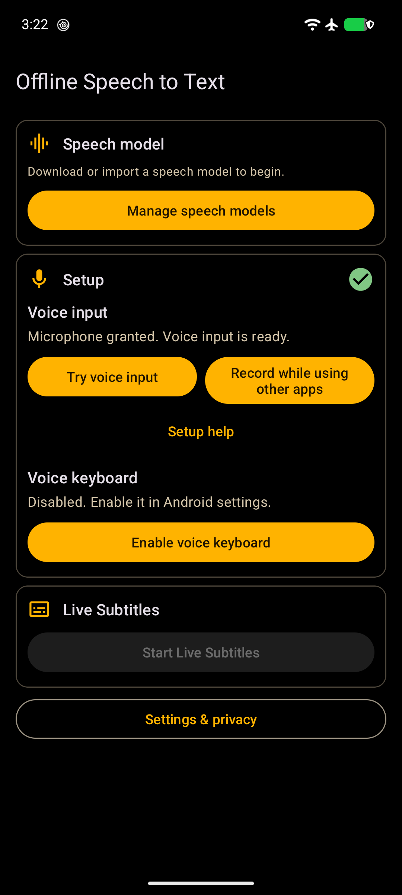
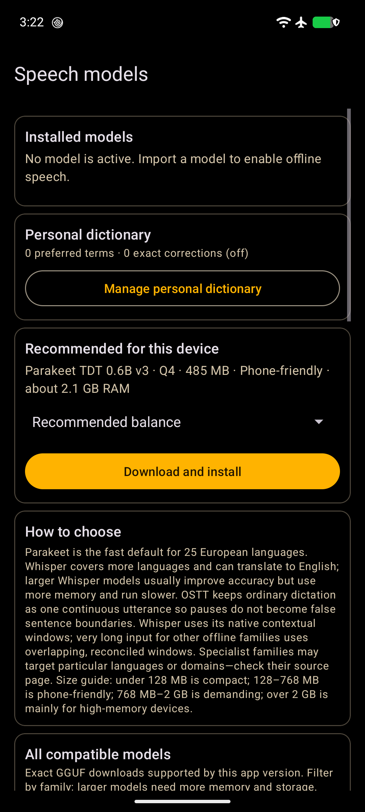
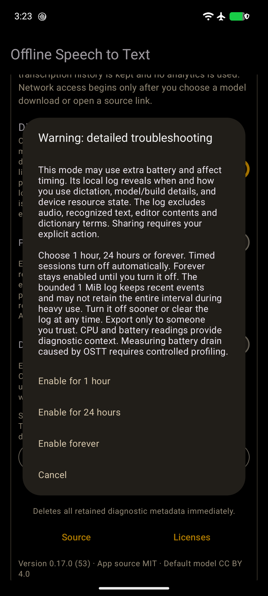

# Offline speech to text for Android

Offline Speech to Text (OSTT) turns speech into text on your Android phone. Recognition runs on the device. Install the app from [Zapstore](https://zapstore.dev/apps/app.offlinespeechtotext); development history lives in the project-owned [source repository](https://gitworkshop.dev/npub1jg2qmt3rxjksq65v3nk7dq6yaz2c4uf3qt9epdhxwms2xwd47j2s38a228/relay.ngit.dev/offline-speech-to-text).

## Features

- Dictate into apps through Android voice input or the optional voice keyboard. The popup supports left-handed and right-handed placement. Ordinary dictation keeps a complete model context through hesitations; long recordings use overlapping windows with boundary reconciliation.
- Recover a completed keyboard transcript when the editor closes. OSTT inserts into the current safe composer after temporary UI recreation. Otherwise it preserves an exact pending transcript for later recovery. Password fields stay blocked.
- Use pause/resume while recording, then choose whether to stay in the voice keyboard after inserting. Hold and drag Backspace to preview the selected range before deleting it. The globe returns to another keyboard.
- Caption device audio with Live Subtitles, or share an audio file for transcription. Audio-file decoding keeps a bounded sliding window; it retains overlap while discarding consumed audio. Dictionary cleanup runs on the complete result.
- Choose a verified speech model for your phone. Parakeet TDT 0.6B v3 Q4 supports 25 European languages. The catalogue also includes Whisper and other Parakeet variants. Recommendations account for available memory and storage; German-primary phones receive a German-tuned option.
- Add preferred words or phrases in one private dictionary. Exact corrections have separate **What was heard** and **Replace with** fields. Matching protects quoted text and code. URLs and email addresses stay literal. Whisper also receives the preferred terms that fit its native prompt.
- Select **Stop after silence** when you want automatic stopping. Choose a 2-second pause, 3 seconds or 5 seconds. Pause suspends microphone capture until Resume. Every interactive session has a ten-minute safety cap that transcribes the captured audio.
- Run the built-in benchmark to compare thread settings for the active model. Automatic inference uses at most two performance cores. Optimized Arm64 inference has a baseline fallback for older phones.
- Choose light or dark appearance, or follow the system setting. A bounded diagnostic log is available for troubleshooting. Detailed troubleshooting requires a separate timed consent; [the diagnostic guide](docs/power-diagnostics.md) explains its contents and limits.

## Screenshots

 

## Set up

1. Open **Manage speech models** and review the recommendation. Tap **Download and install** to fetch the verified model into update-safe private storage.
2. Grant microphone permission when Android requests it. Tap a microphone in a compatible keyboard or app and choose OSTT as the voice-input handler.
3. For the dedicated voice keyboard, open **Keyboard settings** and enable OSTT. Switch to it with Android's keyboard picker.

Model downloads resume after interruptions and verify their exact size and SHA-256 before activation. A failed download preserves the active model. Manual GGUF import through the system file picker remains available. Recognition works offline after setup.

For extended capture, open **Long recording** and select **Start recording**. Its notification offers **Stop and transcribe** or **Stop and discard**. Review the result before explicitly sharing it. The foreground recording flow retains its own lifecycle and notification safeguards.

## Compatibility and fallback

HeliBoard and several other open-source keyboards switch to the configured voice IME. SwiftKey can open the voice-input popup; disable its own multi-modal voice typing when needed. Gboard uses its own voice typing. If the caller fails to accept a result, use OSTT's recovery or copy controls.

Live Subtitles require Android 10 or later and the system screen-audio capture permission. The dedicated voice keyboard supports Android 8 onward. Android's device-wide microphone switch can delay capture; the app waits for real audio before applying the silence policy.

## Android integration

Apps can use OSTT through standard Android APIs. `ACTION_RECOGNIZE_SPEECH` opens the provider-owned popup. `SpeechRecognizer` uses the exported recognition service. A custom app UI can pass caller-captured audio using `EXTRA_AUDIO_SOURCE`; see the [integration guide](docs/android-integration.md) for permissions and executable lifecycle examples.

## Privacy

The app makes no network request on launch. A network connection opens only after the user confirms a model download. Speech recognition and dictionary processing run on the device. Models remain in app-private storage across ordinary updates.

Diagnostics are disabled by default. They contain fixed numeric timing and resource metadata, excluding audio and transcript content. Detailed collection offers 1 hour, 24 hours or continuous collection until manually disabled. Log export requires an explicit Save or Share action. Experimental long-dictation preparation is separately opt-in and disabled by default; its latency and battery effects depend on the phone and model.

## Build and contribute

Use JDK 17 or later with Android SDK 36 and NDK 29.0.14206865. Install Rust's `aarch64-linux-android` target and `cargo-ndk`. The lockfile binds the Rust wrapper to the matching transcribe.cpp 0.4.0 runtime. Configure the SDK path in a local `local.properties` file, then run `./gradlew assembleDebug`. Run `tests/run_focused_tests.sh` for the focused host regressions.

Normal APKs download models after setup. The optional `-PincludeBundledModel=true` build is intended for controlled offline testing. Release updates retain the established package and signing identity. A side-by-side validation build uses `-PisolatedDebugPackage=true`.

## License

The application is distributed under the [MIT license](LICENSE). Speech-model downloads carry their respective model licenses.
